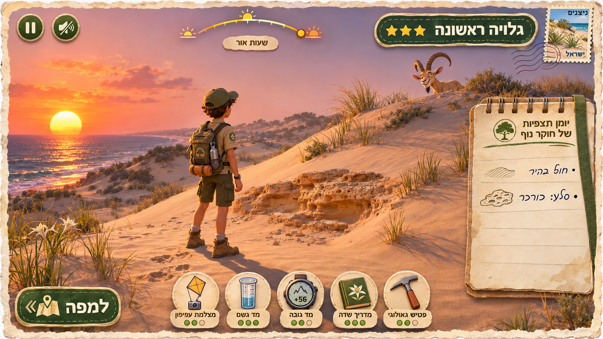
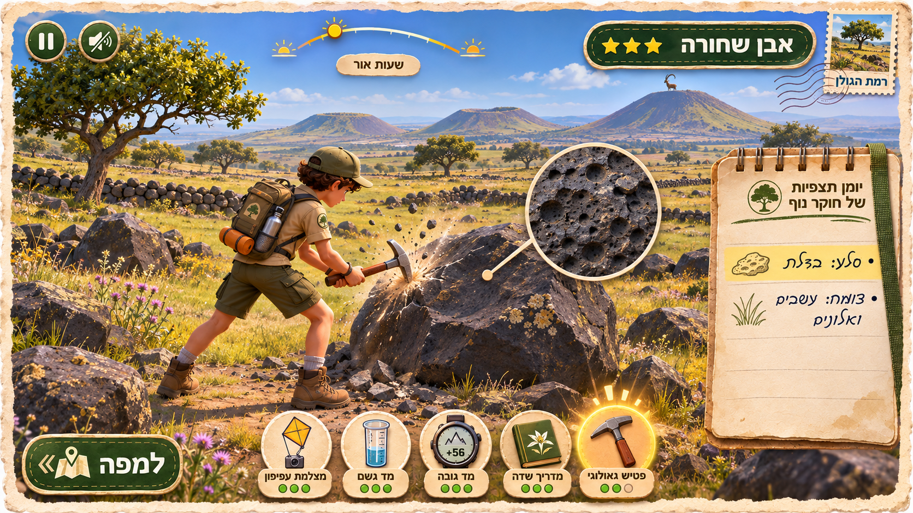
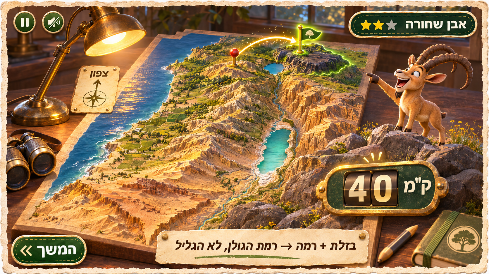
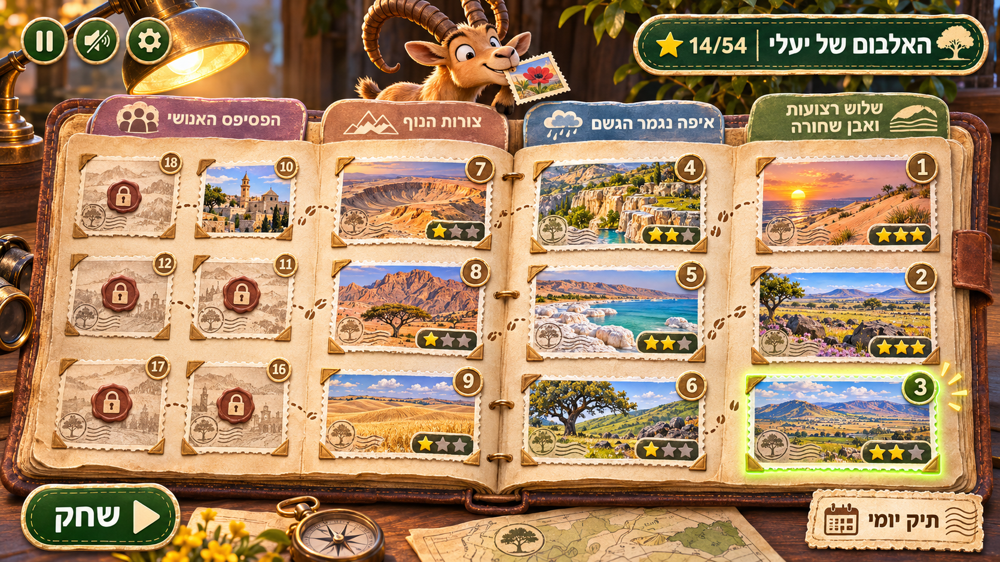

# Visual review — real captures vs. the gameplay mockups

> The real captures are local-only: they live in the git-ignored `scratch/screenshots/` and are not committed (screenshots never go in the repo). Each one can be regenerated with the command next to it, using `scripts/drive.mjs` against the dev server. The mockups in `docs/visual-targets/` are design assets and are committed.

The mockups in `docs/visual-targets/` are the art direction. Every capture below is a real frame from the running game: Playwright drives `scripts/drive.mjs` against the dev server at 1280×720, with deterministic time (`window.advanceTime`). Nothing is painted over. To regenerate, run the commands in the "Capture" column.

Verdict per target: **match** means the composition, HUD and readability goals are met. **gap** means the difference is known and listed honestly.

## 01 — First 30 seconds (Nitzanim dunes, sunset)

| Target | Real |
|---|---|
|  |  |

Capture: `node scripts/drive.mjs "eval:__ld.startCase(__ld_cases[0])" waitfor:explore adv:4000 shot:scratch/screenshots/01-first-30s.png`

- **Match:**
  - Deckle-edged postcard frame and stamp.
  - Title pill with three stars.
  - Sun arc with the "שעות אור" tag.
  - Notebook on the right, already holding a free observation ("נוף: דיונות חול").
  - Five tool buttons at the bottom with Hebrew labels.
  - The "למפה" button at bottom left.
  - Pause and mute top left.
  - Low western sun over the dunes.
  - Ranger seen from behind.
  - Yaeli (the ibex) standing on a dune ahead, off to one side of the reticle.
- **Gap:**
  - The sea is a thin band on the horizon. The real dunes at Nitzanim hide it from the start point until you climb the lookout (see 05).
  - The kurkar outcrop in the mockup is not on this card. The place's rock is sand, and the solver data has no kurkar ridge here.
  - Our charge pips are a single row above the belt, not three pips under each tool. Case 1 has unlimited charges (∞).

## 02 — Core loop (Golan basalt, hammer)

| Target | Real (swing) | Real (reading) |
|---|---|---|
|  |  |  |

Capture: `… startCase(__ld_cases[3]) … key:1 adv:1600 shot:…`, then `adv:2600 wait:500 shot:…` for the reading.

- **Match:**
  - The ranger swings the hammer (the Tripo `chop` clip, with a hammer parented to the right hand).
  - The toast reads "פטיש סלעים: בזלת", and the notebook gains "סלע: בזלת".
  - A magnified, procedurally drawn vesicular rock inset with its Hebrew name pops up on the hit.
  - Tripo vesicular `basalt_boulders` clusters stand in green Golan grassland with oaks.
  - The used tool greys out and one charge pip empties.
  - The basalt-plateau landform note is already in the notebook.
- **Gap:**
  - The Tripo basalt field walls are placed off to the side, not in this frame.
  - The ranger swings at the air in front, not at a specific boulder.
  - The volcanic cones are on the 90 km horizon from real relief, so they are low and soft, not the mockup's tall framed cones.

## 03 — Pin and reveal

| Target | Real (map) | Real (reveal) |
|---|---|---|
|  |  |  |

Capture: `… key:m waitfor:map adv:1500 shot:… "pinat:32.95,35.3" adv:400 key:Enter adv:9000 wait:2000 shot:…`

- **Match:**
  - A lamp-lit tabletop relief model of the real terrain: AWS Terrain Tiles with 7× vertical exaggeration and a hypsometric tint, with the Kinneret, the Dead Sea and a snow-white Hermon.
  - The north card.
  - A brass pin with a red head.
  - A dashed arc from the pin to a green flag at the truth.
  - The true zone outlined, and city names that appear only at the reveal.
  - Yaeli on the model.
  - A big "48 ק״מ" counter with points.
  - An explain strip in the "בזלת + רמה → רמת הגולן, לא הגליל" form, with the trap text.
  - The "המשך" button.
- **Gap:**
  - North stays straight up rather than on the mockup's diagonal, because the game teaches "צפון תמיד למעלה במפה".
  - The table has no props (lamp, binoculars, notebook); a CSS vignette stands in for the lamp light.
  - The ibex on the map is small.

## 04 — Level select (album)

| Target | Real |
|---|---|
|  |  |

- **Match:**
  - Four world pages, each with a coloured tab.
  - Each postcard thumbnail is a real HUD-free gameplay frame (`public/thumbs/case-N.jpg`).
  - Stars per case and a total of 17/54.
  - Locked cases are sepia with a lock.
  - The next playable case is highlighted.
  - The "תיק יומי" (daily case) and "שחק" buttons.
- **Gap:**
  - Thumbnails show the ranger from behind rather than a painted vignette.
  - The highlighted card overlaps the name of the card above it by a few pixels.

## Extra captures (not in the mockups)

| | |
|---|---|
| Lookout over the sea, Apollonia  | Night card: only the sea is heard  |
| Makhtesh Ramon from the rim lookout (floor tint and strata)  | Dead Sea shore, Ein Gedi  |
| Nazareth from the kite camera (dense town, minaret, market)  | Intro card  |

## Fixes made during this review

- **Basalt outcrop:** it rendered as black shards because a non-indexed polyhedron was jittered per vertex. Jitter now hashes by position, and the outcrop uses Tripo `basalt_boulders`.
- **Lake and coast spawns:** six places spawned the ranger on the SRTM water surface (Dor, Ein Gedi, the sinkholes, Coral Beach, Tiberias, the Jordan inflow). They now start on the nearest dry shore, facing the water. The lake surface is taken from the commonest low height, and the shore shelves under it.
- **Ramon:** the start moved to the real rim edge in the relief data, facing the crater. The floor below the rim takes a warm tint, and dry sedimentary slopes show strata bands.
- **Lookout:** the Tripo lookout tower is hidden while you are on its deck, so its posts never fill the first-person view.
- **Opening views:** large trees, boulders and props are kept out of the first 40 m in front of the start heading.
- **Map:**
  - Framing tightened, with a vignette.
  - The reveal camera stays steeper near the north edge so it doesn't look past the model.
  - The "N" sprite moved onto the sea so it never sits on a reveal zone.
- **Dense towns** pack tighter, so they read as built-up from the kite camera.
- **The ibex** now stands 22–40 m out, beside the reticle, instead of 55–115 m away.
